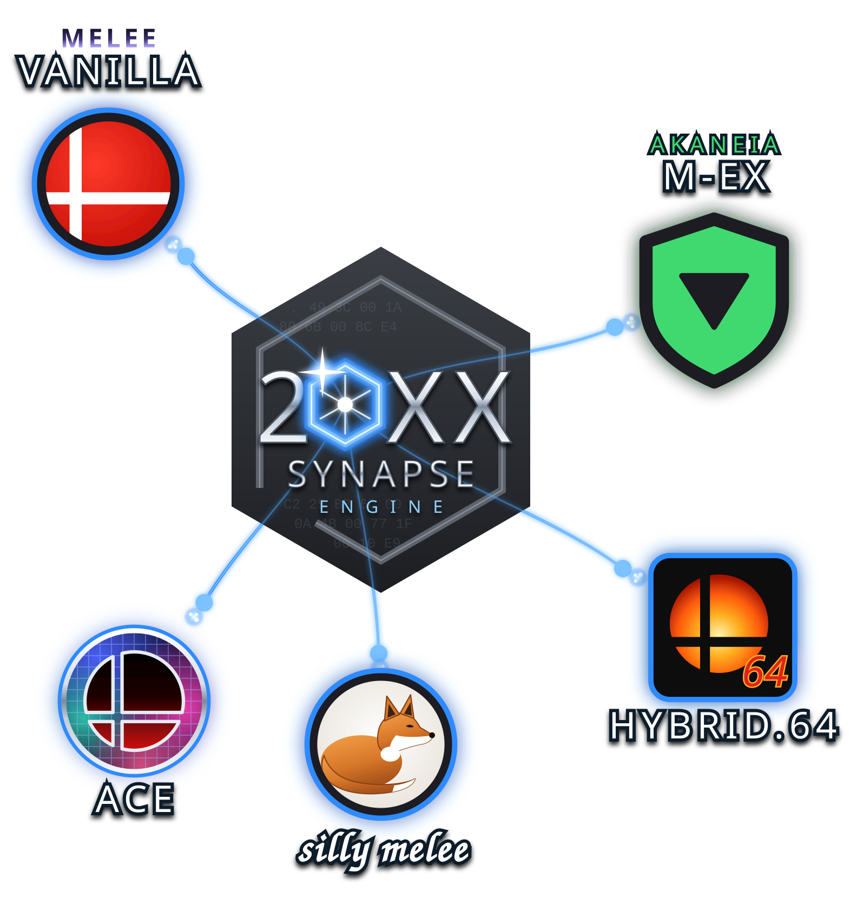

# 20XX Synapse Engine

<p align="center"><a href="https://github.com/w3irDv/20XX-Synapse_Engine/" title="20XX-Synapse_Engine"></a></p>
<p align="center">
<a href="https://github.com/w3irDv/20XX-Synapse_Engine/releases" title="Releases"></a>
</p>

## What Synapse is

Synapse brings the **20XX CPU AI** to Super Smash Bros. Melee (NTSC 1.02), on vanilla Melee and on mods built on it.
The 20XX AI is the "advanced" CPU from the 20XX Training Hack Pack: it wavedashes, dash-dances, shields and answers
out of shield, techs and DIs, recovers and edgeguards. Synapse adds it to your Melee mod together with:

- a **CPU selector** on the D-pad and a **CPU config menu** (see [In a match](#in-a-match));
- the 20XX **DI, smash DI, tech and Nana-throw** reactions;
- the 20XX **CPU rules**: CPUs L-cancel, never taunt, Captain Falcon never rapid-jabs, Sheik / Zelda never transform,
  each switchable in the menu.

It also drives characters added by Akaneia or SSBM ACE: by default they play the 20XX AI as Donkey Kong (with their
own moves); the menu's **ADDED FIGHTERS PLAY AS** line picks another character, or OFF for Melee's own CPU. Your
original ISO is never modified: Synapse writes a new one.

## Why Synapse?

20XX Melee Training Hack Pack is one of the most incredible Melee mods of all time. Apart from its huge number of
stages and endless tunes, it brings you a killer AI engine that is light-years apart from the vanilla Melee one that
all other mods inherit. I like to play solo, and after playing against a 20XX Fox, all other mods seem really
boring... But I also like to play new stages, new characters and different music... so why not connect the 20XX AI
Engine to your preferred mod and enjoy the best of both worlds? That's what Synapse is: the neural connection between
20XX HP and any mod!

## Get it: three ways

| Way | What you get | Where | How-to |
|---|---|---|---|
| **Synapse Builder** (recommended) | a window (and a console tool) for Windows and Linux; **AI-only** or **Full** package; nothing to install | [Releases](https://github.com/w3irDv/20XX-Synapse_Engine/releases): `synapse-builder-…-windows-x64.zip`, `…-linux-x64.tar.gz` | [docs/builder.md](docs/builder.md) |
| **xdelta patches** | ready-made patches for the tested ISOs | *coming later* | — |
| **AI-only scripts** | AI-only package, with only the shell your system already has (PowerShell or bash) | [Releases](https://github.com/w3irDv/20XX-Synapse_Engine/releases): `synapse-scripts-…-ai-only.zip`, or the [`scripts/windows`](scripts/windows/) / [`scripts/linux`](scripts/linux/) folders | [Windows](docs/scripts-windows.md) · [Linux](docs/scripts-linux.md) |

**The two packages:**

- **AI-only**: everything listed above. Output `<name>.aionly.iso`.
- **Full**: AI-only plus the **GLOBAL CONFIGURATION** menu and the community features, each switched on or off **in
  game** (options saved to the memory card): UCF 0.84, Flash Red on a failed L-cancel, Z-Jump, true widescreen, the
  Arcade Melee camera, hitbox display, random stage music, CSS Stars, the character and stage random pools. A variant
  for a **real Wii on a flat screen** adds Force 480p and the polling-drift fix. Output `<name>.full.iso`. Builder only.

## What you need

- **A Melee NTSC 1.02 ISO** you own, uncompressed (`.iso` / `.gcm`), **without** Synapse already in it:
  - vanilla Melee NTSC 1.02 (Tournament Mode keeps working);
  - hybrid.64 v3.2 (Slippi or vanilla build), Akaneia or SSBM ACE v2.0.0;
  - Silly Melee v1.01;
  - also tested: SSBM Custom Stages Expansion 0.91, SSBM ULTRA v2.4 CSE 0.91, Arcade Melee Demo 2.0;
  - another mod built on NTSC 1.02, if it passes the builder's checks ([how the builders judge an ISO](docs/BUILD_DETAILS.md)).

  20XX itself is not supported. Compressed images (`.nkit.iso`, `.rvz`, `.ciso`, `.wbfs`) must first be converted to
  a plain ISO with Dolphin (right-click the game → Convert File… → ISO).
- Free disk space for one more copy of your ISO (1.4–1.7 GB).

## Quick start

**Synapse Builder:** download the archive for your system from
[Releases](https://github.com/w3irDv/20XX-Synapse_Engine/releases), extract it, run **`synapse-gui`**, choose your
ISO, pick **AI-only** or **Full**, press **Build**. The new ISO is written next to yours. On Windows, the first run
may show "Windows protected your PC": **More info → Run anyway**. On Linux, `chmod +x synapse-gui synapse-cli` if
needed. Details: [docs/builder.md](docs/builder.md).

**AI-only scripts:** on Windows, drag your ISO onto **`scripts\windows\Build-SynapseIso.cmd`**; on Linux, run
`./build-synapse-iso.sh --source ~/Games/Melee.iso` in `scripts/linux`. Keep `scripts/common` next to the script's
folder. Details: [Windows](docs/scripts-windows.md) · [Linux](docs/scripts-linux.md).

### Check your download (optional)

Each release lists the archives' SHA-256 in `SHA256SUMS.txt`, signed in `SHA256SUMS.txt.sig` with the key in
[`allowed_signers`](allowed_signers) at the root of this repository. Put the three files next to your archive, then:

```powershell
# Windows (PowerShell): compare the hash with your archive's line in SHA256SUMS.txt, then check the signature
Get-FileHash .\synapse-*.zip
cmd /c "ssh-keygen -Y verify -f allowed_signers -I w3irDv -n file -s SHA256SUMS.txt.sig < SHA256SUMS.txt"
```

```bash
# Linux
sha256sum -c --ignore-missing SHA256SUMS.txt
ssh-keygen -Y verify -f allowed_signers -I w3irDv -n file -s SHA256SUMS.txt.sig < SHA256SUMS.txt
```

A good download prints `OK` for your archive and `Good "file" signature for w3irDv`. `ssh-keygen` comes with
OpenSSH: on Windows 10 / 11 it is the optional feature **OpenSSH Client** (Settings → System → Optional features),
usually already installed; on Linux, the `openssh-client` package.

## In a match

Everything uses **controller 1**. The most used buttons:

| Buttons | Does |
|---|---|
| **Z + D-Down** | switch between the **20XX AI** and Melee's own CPU types |
| **Z + D-Left / D-Right** | previous / next CPU type; on 20XX: previous / next 20XX subtype |
| **A + D-pad** | toggle Invincibility (Up), No Damage (Right), Infinite Shield (Down), Timer Freeze (Left) |
| **B + D-pad** | damage −5 / +5 %: player 1 (Left / Right), player 2 (Down / Up) |
| **Z + D-Up** | open the **CPU config menu** (the match freezes); move and change values with the **stick**, **START** closes it |

The menu tunes how the 20XX AI plays (aggression, shield and out-of-shield habits, SHFFL aerials, DI, tech and getup
choices, …), holds the 20XX CPU rules and, in Full, the GLOBAL CONFIGURATION features. Every button and option:
[docs/CONTROLS.md](docs/CONTROLS.md).

## After the build

The builder ends with a few lines under **`== Recap`**: read them first. They say whether it worked and what to do
next. Then open the new ISO in Dolphin (or load it on your console as usual), start a VS match with a CPU, and press
**Z + D-Down** to give it the 20XX AI.

**Dolphin Gecko codes:** a Gecko code you enabled in Dolphin for GALE01 applies to **every** GALE01 ISO, a Synapse ISO
too, and overrides the feature built in (it can even crash a mod). Turn them off for Synapse ISOs (right-click the
game → Properties → Gecko Codes).

If something fails, each how-to has a troubleshooting table, and [docs/BUILD_DETAILS.md](docs/BUILD_DETAILS.md)
explains every check and exit code. Tested an ISO that isn't listed above? Please
[open an issue](https://github.com/w3irDv/20XX-Synapse_Engine/issues/new) titled `Tested ISO: mod_name` with the
`== REPORT` block the builder printed.

## Gecko codes

Synapse's own codes (the 20XX CPU rules, CSS Stars, the random pools, …), for use **without** a Synapse ISO, are in
[`geckos/`](geckos/): see [docs/gecko-codes.md](docs/gecko-codes.md).

## Documentation

| Document | For |
|---|---|
| [docs/builder.md](docs/builder.md) | the Synapse Builder: window, console, packages, untested ISOs |
| [docs/scripts-windows.md](docs/scripts-windows.md), [docs/scripts-linux.md](docs/scripts-linux.md) | the AI-only scripts |
| [docs/CONTROLS.md](docs/CONTROLS.md) | every in-match button and menu option |
| [docs/BUILD_DETAILS.md](docs/BUILD_DETAILS.md) | how the builders judge an ISO: eligible ISOs, untested ISOs, added content, checks, exit codes |
| [docs/gecko-codes.md](docs/gecko-codes.md) | the paste-ready Gecko codes and the community codes Synapse bakes |
| [`source/builder`](source/builder/) | for rebuilding the executables: the Rust source (and, next to it, `source/full`, the Full pack) |

*Moved:* the files that used to be under `release/` are now in `docs/`, `scripts/` and `source/`.

## Licence

Synapse's own work is MIT ([LICENSE](LICENSE)). Third-party code keeps its own terms, and the community work Synapse
includes without a licence is credited in [NOTICE.md](NOTICE.md).

## Credits

* The [20XX Melee Training Hack Pack](https://smashboards.com/threads/the-20xx-melee-training-hack-pack-v5-0-2-1-20-2023.351221/) and its 20XX AI Engine were created by Achilles1515 and expanded by DRGN-DRC. All the credit goes to them. Thanks for creating, in my opinion, the most revolutionary and complete Melee mod, in code, music, stages and endless options, and for publishing the notes and source code that made this port possible.
* Thanks to Punkline for all their contributions to the Melee mod community and for the libraries in the Hack Pack.
* Thanks to UnclePunch, Ploaj, and all members of the Akaneia team for [m-ex](https://github.com/akaneia/m-ex).
* Thanks to the SSBM ACE team for [SSBM ACE](https://github.com/Chri222k/ACE-BUILD-PUBLIC-/), which Synapse also supports.
* Thanks to Cjag for bringing us [Hybrid 64](https://gamebanana.com/mods/40702), which, besides being so much fun to play, also taught us a practical lesson on how to safely extend a DOL.
* Thanks to the Silly Melee team for [Silly Melee](https://smashboards.com/threads/silly-melee-released-today.426631/), which Synapse also supports.
* Thanks to the authors of the community Gecko codes the Full package includes: see [NOTICE.md](NOTICE.md).
* Thanks to 2gifts for Enhanced Random Character gecko.
* Thanks to the Melee modding community for the GALE01 symbol map and years of shared research.
* The injection code has been AI-(reverse-)engineered using as a base the original 20XX Hack Pack, m-ex repos and Hybrid 64 binaries.
